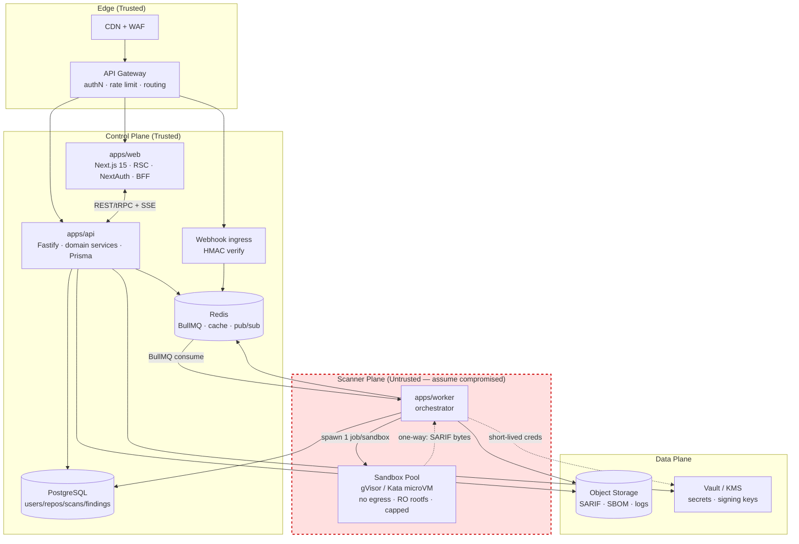
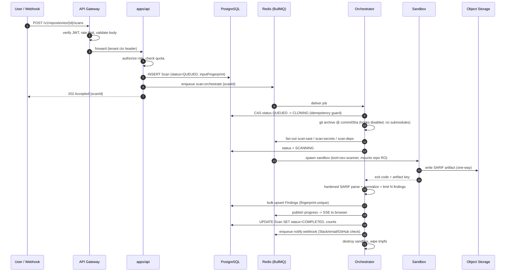

# Syscanner — Technical Architecture

> **SAST · Secrets Detection · Dependency Vulnerability Scanning for Multi-Tenant SaaS**
>
> Document owner: Lead Security Engineer / Principal Architect
> Status: **Draft for implementation** · Version `0.1.0`

---

## Table of contents

1. [Design principles & trust model](#0-design-principles--trust-model)
2. [System architecture](#1-system-architecture)
3. [Monorepo directory structure (Turborepo)](#2-monorepo-directory-structure-turborepo)
4. [Database schema (Prisma / PostgreSQL)](#3-database-schema-prisma--postgresql)
5. [Security best practices for sandboxed workers](#4-security-best-practices-for-sandboxed-workers)
6. [Local development](#5-local-development)
7. [Validation gates](#6-validation-gates)
8. [Related documents](#7-related-documents)

---

## 0. Design principles & trust model

The single most important architectural decision: **the scanner plane is untrusted,
the control plane is trusted, and data flows one-way from sandbox → storage.**

| Plane | Runs | Trust | Network | Holds credentials? |
|---|---|---|---|---|
| **Edge** | CDN, WAF, API Gateway | Trusted | Public | TLS keys only |
| **Control plane** | Next.js, API service, PostgreSQL, Redis | Trusted | Private VPC | Yes (scoped, short-lived) |
| **Scanner plane** | Sandboxes running Semgrep / Gitleaks / OSV-Scanner | **Hostile input; assumed compromised** | **No egress by default** | **Never** |

**Core invariant:** *a fully compromised sandbox must be able to do nothing except emit
bytes to a one-way channel.*

Supporting principles:

1. **One job = one throwaway container.** No reuse, no shared state, immutable images.
2. **Never execute repository code.** Parse lockfiles and source; do not build, install
   or run hooks.
3. **Findings are data, never instructions.** Every byte leaving a sandbox is validated,
   size-capped and escaped before it reaches the database or the UI.
4. **Fail closed.** Unknown scanner config, unknown image digest, unknown runtime →
   refuse to run rather than silently degrade isolation.
5. **Everything is attributable.** Every scan records the exact commit SHA, policy
   version, tool versions and worker image digest for reproducibility.

---

## 1. System architecture

### 1.1 Component overview (ASCII)

```
                                   ┌───────────────────────────────────────────┐
                                   │        Edge: CDN + WAF + DDoS shield      │
                                   └────────────────────┬──────────────────────┘
                                                        │ TLS 1.3
        ┌───────────────┐   HTTPS                       ▼
        │   Browser     │───────────▶ ┌───────────────────────────────────────┐
        │ (React/RSC)   │◀─────────── │  API GATEWAY (Kong / Envoy / AWS APIGW)│
        └───────┬───────┘    SSE/WS   │  • JWT/JWKS verify  • rate limit       │
                │                    │  • tenant routing   • body-size cap    │
                │                    │  • schema validation at the edge       │
                │                    └───────┬───────────────────┬───────────┘
                │                            │                   │
                │              ┌─────────────┘                   └──────────────┐
                ▼              ▼                                               ▼
   ┌────────────────────────┐  ┌────────────────────────────┐      ┌───────────────────────┐
   │  apps/web  (Next.js)   │  │  apps/api  (Fastify/TS)    │      │  Webhook ingress      │
   │  • RSC dashboard       │◀▶│  • domain services         │      │  (GitHub/GitLab push) │
   │  • BFF route handlers  │  │  • Prisma access           │      │  → verify HMAC        │
   │  • NextAuth            │  │  • authZ + quotas          │      │  → enqueue scan       │
   │  • findings UI/SARIF   │  │  • enqueue BullMQ jobs     │      └───────────────────────┘
   └───────────┬────────────┘  └───┬─────────────────┬──────┘
               │ SSE progress      │                 │
               │                   ▼                 ▼
               │        ┌────────────────┐   ┌──────────────────────────────┐
               │        │  PostgreSQL    │   │  REDIS                       │
               │        │  (Prisma)      │   │  • BullMQ queues             │
               │        │  users/repos/  │   │  • rate-limit counters       │
               │        │  scans/findings│   │  • scan progress pub/sub     │
               │        └────────────────┘   │  • distributed locks (dedupe)│
               │                             └───────────┬──────────────────┘
               │                                         │ BullMQ consumer
               │                                         ▼
               │                     ┌──────────────────────────────────────────────┐
               │                     │  apps/worker  — ORCHESTRATOR                  │
               │                     │  1. claim ScanJob (idempotent by fingerprint) │
               │                     │  2. fetch-by-commit → tmpfs (no .git hooks)   │
               │                     │  3. fan-out per-tool jobs                     │
               │                     │  4. collect + parse SARIF (hardened parser)   │
               │                     │  5. bulk upsert Findings → Postgres           │
               │                     │  6. publish progress to Redis pub/sub         │
               │                     └───────────────┬──────────────────────────────┘
               │                                     │ run ONE container per (scan,tool)
               │                                     ▼
               │   ┌─────────────────────────────────────────────────────────────────┐
               │   │  SANDBOX POOL — gVisor (runsc) / Kata microVM                   │
               │   │  non-root · read-only rootfs · all caps dropped · seccomp       │
               │   │  cgroup v2: cpu/mem/pids/io caps + hard wall-clock timeout       │
               │   │  network: NONE (or allowlist proxy for advisory DBs only)        │
               │   │                                                                 │
               │   │   ┌──────────┐  ┌───────────┐  ┌─────────────┐  ┌────────────┐   │
               │   │   │ semgrep  │  │ gitleaks  │  │ osv-scanner │  │ trivy/SBOM │   │
               │   │   │ (SAST)   │  │ (secrets) │  │ (deps/CVE)  │  │ (license)  │   │
               │   │   └──────────┘  └───────────┘  └─────────────┘  └────────────┘   │
               │   └───────────────────────┬─────────────────────────────────────────┘
               │                           │ ONE-WAY: SARIF + exit code only
               │                           ▼
               │              ┌────────────────────────┐   ┌────────────────────────┐
               │              │  Object Storage (S3)   │   │  Vault / KMS           │
               │              │  raw SARIF, SBOMs, logs│   │  SCM tokens, TOTP,     │
               │              │  (encrypted, TTL'd)    │   │  webhook secrets, keys │
               └─────────────▶└────────────────────────┘   └────────────────────────┘
                     SSE / polling for live scan progress
```

### 1.2 Component & trust boundaries (Mermaid)



### 1.3 Scan lifecycle (Mermaid sequence)



### 1.4 Ports & local topology

| Service | Port | Notes |
|---|---|---|
| `apps/web` (Next.js) | 3000 | SSR/RSC dashboard + BFF route handlers |
| `apps/api` (Fastify) | 4000 | Only service with direct DB write access |
| PostgreSQL | 5432 | Prisma datasource |
| Redis | 6379 | BullMQ + pub/sub + rate-limit counters |
| MinIO (S3 dev) | 9000 | SARIF / SBOM / log artifacts |
| Sandbox runner | n/a | Ephemeral, no ports, no inbound listeners |

### 1.5 API surface (v1)

| Method | Path | Purpose |
|---|---|---|
| `POST` | `/v1/repositories` | Connect a repository (OAuth or PAT via Vault ref) |
| `GET` | `/v1/repositories` | List tenant repositories |
| `POST` | `/v1/repositories/:id/scans` | Trigger a scan → `202 Accepted` |
| `GET` | `/v1/scans/:id` | Scan status + aggregate severity counts |
| `GET` | `/v1/scans/:id/findings` | Paginated findings for a scan |
| `GET` | `/v1/scans/:id/stream` | SSE progress stream |
| `GET` | `/v1/findings` | Cross-repo finding search (severity, CVE, path) |
| `PATCH` | `/v1/findings/:id` | Transition status (IGNORED / FALSE_POSITIVE / …) |
| `POST` | `/v1/webhooks/github` | HMAC-verified push/PR ingress |

### 1.6 Scratch directory lifecycle

Every scan gets a directory under `WORKER_SCRATCH_DIR` containing the read-only
checkout (`src/`) and the sandbox's only writable mount (`out/`). Its lifetime is the
easiest thing in this design to get wrong — and it *was* wrong in the first cut of
this codebase, where the only `rm` call ran at the **start** of a scan and nothing
ever deleted the tree afterwards. Directories accumulated until the disk filled, and
a comment claimed a `finally` block did the cleanup when none existed.

Ownership is now explicit:

| Phase | Owner | Behaviour |
|---|---|---|
| Start of a scan | `orchestrateScanJob` | `prepareScanScratch` wipes any leftover, then creates `src/` and `out/` |
| While scanning | The `ScanTask` jobs | The tree **must** survive: each scanner reads `src/` and writes `out/` |
| Terminal (COMPLETED / PARTIAL) | `finalizeScan` | `cleanupScanScratch` once every task has settled |
| Fetch failure | `orchestrateScanJob`'s `catch` | Releases immediately; the tree is unusable |
| Worker killed mid-scan | The reaper interval | `sweepStaleScratch` removes trees older than 2× the sandbox timeout |
| `scan_repository` jobs | `scanRepositoryJob` | A literal `try…finally` — one process owns the whole lifecycle |

That last row is the important distinction: a `finally` in `orchestrateScanJob` would
delete the source tree while the scanner jobs it had just enqueued still needed it.
`scanRepositoryJob` does not fan out, so it *can* and *does* clean up inline.

Two properties make this safe:

- **`cleanupScanScratch` never throws.** It logs and returns `false`; a cleanup
  failure must not fail an otherwise-complete scan. `rm` uses `maxRetries: 3` because
  Windows holds file handles inside `.git`.
- **Scan ids are validated against `^[A-Za-z0-9_-]{1,64}$` before becoming a path
  segment.** Without that check, an id containing `../` would turn the cleanup
  `rm -rf` into an arbitrary-directory delete. The same constraint is enforced on
  `scanRepositoryJobSchema.jobId` at the queue boundary.

---

## 2. Monorepo directory structure (Turborepo)

> The two legacy empty folders (`Backend/`, `Frontend/`) were removed in favour of this
> layout. Everything is TypeScript compiled to CommonJS so that plain `node dist/index.js`
> works without ESM extension gymnastics.

```
Syscanner/
├─ apps/
│  ├─ web/                            # Next.js 15 (App Router) — dashboard & BFF
│  │  ├─ app/
│  │  │  ├─ page.tsx                  # overview + severity legend
│  │  │  ├─ repositories/page.tsx     # connected repositories
│  │  │  ├─ scans/[scanId]/page.tsx   # scan summary + findings table
│  │  │  ├─ scans/[scanId]/code/page.tsx  # Monaco code viewer (fixture-backed demo)
│  │  │  ├─ api/scans/[scanId]/stream/route.ts   # SSE progress (BFF, no DB)
│  │  │  ├─ layout.tsx
│  │  │  └─ globals.css
│  │  ├─ components/code-viewer/
│  │  │  ├─ VulnerabilityCodeViewer.tsx  # client component: editor + sidebar
│  │  │  ├─ VulnerabilitiesSidebar.tsx   # interactive findings panel
│  │  │  ├─ CodeViewerMount.tsx          # dynamic(ssr:false) wrapper
│  │  │  ├─ decorations.ts               # PURE: findings -> Monaco decorations
│  │  │  ├─ monaco-setup.ts              # loader.config + web workers (self-hosted)
│  │  │  └─ decorations.test.ts
│  │  ├─ lib/                         # api client, demo fixtures
│  │  ├─ next.config.mjs
│  │  ├─ tailwind.config.ts
│  │  ├─ tsconfig.json                # overrides base: jsx, noEmit, bundler
│  │  └─ package.json
│  │
│  ├─ api/                            # Fastify API gateway (domain services)
│  │  ├─ src/
│  │  │  ├─ index.ts                  # bootstrap + graceful shutdown
│  │  │  ├─ app.ts                    # Fastify instance factory (testable)
│  │  │  ├─ config.ts                 # validated env
│  │  │  ├─ tenant.ts                 # resolves the organisation, blocks cross-tenant
│  │  │  ├─ plugins/                  # prisma, queues (BullMQ producer)
│  │  │  └─ routes/                   # health, repositories, scans, findings
│  │  ├─ Dockerfile
│  │  └─ package.json
│  │
│  ├─ worker/                         # BullMQ consumers (orchestrator + scanners)
│  │  ├─ src/
│  │  │  ├─ index.ts                  # bootstrap, queue routing, finalize, reaper
│  │  │  ├─ config.ts                 # validated env, incl. every sandbox limit
│  │  │  ├─ scratch.ts                # per-scan scratch directory lifecycle
│  │  │  ├─ ingest.ts                 # fingerprints -> Finding rows + aggregates
│  │  │  ├─ processors/
│  │  │  │  ├─ orchestrateScan.ts     # fetch + fan out   (scan:orchestrate)
│  │  │  │  ├─ scanRepository.ts      # self-contained URL scan (scan:repository)
│  │  │  │  ├─ runScanner.ts          # one tool for an existing scan
│  │  │  │  └─ executeSandboxedTool.ts # shared: run sandbox -> parse report
│  │  │  ├─ sandbox/                  # provider abstraction (docker | gvisor | kata)
│  │  │  ├─ git/                      # fetchByCommit, validateCloneUrl
│  │  │  └─ dev/scanOneRepo.ts        # UNSAFE dev-only local scanner
│  │  ├─ Dockerfile
│  │  └─ package.json
│  │
│  └─ sandbox-runner/                 # ENTRYPOINT executed INSIDE the sandbox
│     ├─ src/main.ts                  # reads job spec, execs tool, emits SARIF
│     └─ Dockerfile                   # distroless, no shell, no package manager
│
├─ packages/
│  ├─ db/            # Prisma schema, generated client, seed
│  ├─ core/          # pure domain logic: severity, fingerprint, redaction, policy
│  ├─ queue/         # BullMQ queue names, zod job contracts, producer
│  ├─ scanners/      # tool adapters (semgrep, gitleaks, osv-scanner, trivy)
│  ├─ contracts/     # zod DTOs shared by web / api / worker
│  ├─ logger/        # pino with redaction-aware serializers
│  ├─ crypto/        # KMS envelope encryption, HMAC verification, token hashing
│  ├─ config/        # shared tsconfig presets + prettier config
│  ├─ ui/            # shared React components (Tailwind)
│  └─ testing/       # hostile-repo fixtures + mock scanners
│
├─ infra/
│  ├─ docker/docker-compose.yml       # postgres + redis + minio for local dev
│  ├─ sandbox/seccomp-profile.json
│  ├─ sandbox/networkpolicy-deny-egress.yaml
│  └─ sandbox/runtimeclass-gvisor.yaml
│
├─ docs/architecture/{ARCHITECTURE,THREAT-MODEL,RUNBOOK}.md
├─ .github/workflows/{ci.yml,malicious-repo-tests.yml}
├─ turbo.json · pnpm-workspace.yaml · tsconfig.base.json · .env.example
└─ package.json
```

### 2.1 Dependency rules (enforced by review + CI)

- `apps/*` may import `packages/*`. `packages/*` may **not** import `apps/*`.
- **`packages/scanners`, `apps/worker/src/sandbox` and `apps/sandbox-runner` are
  sandbox-only.** They must never be imported by `apps/api` or `apps/web` — the API
  process must not contain code that shells out to scanners.
- Only `packages/db` depends on `@prisma/client`. Every other package imports
  `@syscanner/db`.

---

## 3. Database schema (Prisma / PostgreSQL)

The **canonical schema is [`packages/db/prisma/schema.prisma`](../packages/db/prisma/schema.prisma)**
— that file is validated in CI and is the source of truth. This section documents the
model and the reasoning; it deliberately shows the core models in full and summarizes
the supporting ones, so the two cannot drift.

**Models:** `Organization`, `User`, `Membership`, `ApiToken`, `Repository`, `Scan`,
`ScanTask`, `Finding`, `FindingSuppression`, `AuditLog`, `NotificationChannel`.

```
Organization ──┬── Membership ─── User
               ├── Repository ──┬── Scan ──┬── ScanTask ─── Finding
               ├── ApiToken     │          └── Finding
               ├── AuditLog     └── FindingSuppression
               └── NotificationChannel
```

### 3.1 Enums

```prisma
enum Role             { OWNER ADMIN MEMBER VIEWER }
enum ScmProvider      { GITHUB GITLAB BITBUCKET AZURE_DEVOPS GENERIC_GIT }
enum ScanTrigger      { MANUAL WEBHOOK SCHEDULE API CLI }
enum ScanStatus       { QUEUED CLONING SCANNING PARSING COMPLETED PARTIAL FAILED CANCELLED }
enum ScannerKind      { SAST SECRETS DEPENDENCY LICENSE IAC CONTAINER SBOM }
enum TaskStatus       { PENDING RUNNING SUCCEEDED FAILED TIMED_OUT SKIPPED }
enum Severity         { CRITICAL HIGH MEDIUM LOW INFO UNKNOWN }
enum FindingStatus    { OPEN RESOLVED IGNORED FALSE_POSITIVE WONT_FIX }
enum Confidence       { HIGH MEDIUM LOW }
enum NotificationType { SLACK TEAMS EMAIL WEBHOOK GITHUB_CHECK }
```

> In the real schema each enum value sits on its own line — Prisma rejects the compact
> one-line form, and the failure surfaces as ~57 cascading "not a valid enum value"
> errors rather than one clear message.

### 3.2 Users and tenancy

```prisma
model User {
  id            String    @id @default(cuid())
  email         String    @unique
  emailVerified DateTime?
  name          String?
  avatarUrl     String?
  passwordHash  String?          // null for SSO-only accounts; Argon2id when set
  mfaEnabled    Boolean   @default(false)
  mfaSecretEnc  Bytes?           // KMS envelope-encrypted TOTP seed
  isActive      Boolean   @default(true)
  lastLoginAt   DateTime?
  createdAt     DateTime  @default(now())
  updatedAt     DateTime  @updatedAt

  memberships  Membership[]
  apiTokens    ApiToken[]
  scans        Scan[]              @relation("ScanTriggeredBy")
  suppressions FindingSuppression[]
  auditLogs    AuditLog[]

  @@index([createdAt])
}
```

A `User` is never a tenancy boundary on its own: `Membership` joins a user to an
`Organization`, and **every** tenant-scoped table carries `organizationId` so a
single forgotten `WHERE` cannot leak across tenants.

`passwordHash` is nullable (SSO-only accounts) and `mfaSecretEnc` is `Bytes`, i.e.
`bytea` in Postgres, because it holds KMS-enveloped ciphertext rather than a
plaintext TOTP seed.

### 3.3 Repositories

```prisma
model Repository {
  id             String      @id @default(cuid())
  organizationId String
  provider       ScmProvider
  providerRepoId String                    // provider's own id; stable across renames
  fullName       String                    // "acme/backend"
  cloneUrl       String
  defaultBranch  String      @default("main")
  isPrivate      Boolean     @default(true)
  isArchived     Boolean     @default(false)
  language       String?
  sizeKb         Int?

  // NEVER persist an SCM credential here — only a pointer into Vault/KMS.
  credentialRef    String?
  // KMS envelope-encrypted webhook HMAC secret.
  webhookSecretEnc Bytes?

  scanConfig Json @default("{}")           // scanners, excludes, failure threshold
  lastScanAt DateTime?
  createdAt  DateTime @default(now())
  updatedAt  DateTime @updatedAt
  deletedAt  DateTime?

  organization Organization          @relation(fields: [organizationId], references: [id], onDelete: Cascade)
  scans        Scan[]
  findings     Finding[]
  suppressions FindingSuppression[]

  @@unique([organizationId, provider, providerRepoId])
  @@unique([organizationId, fullName])
  @@index([organizationId, lastScanAt(sort: Desc)])
}
```

`credentialRef` is a string such as `vault://scm/acme/backend`. The database never
holds a usable token, so a database dump does not hand an attacker read access to
every customer's source code.

### 3.4 Scans

```prisma
model Scan {
  id             String      @id @default(cuid())
  organizationId String
  repositoryId   String
  triggeredById  String?
  trigger        ScanTrigger @default(MANUAL)
  status         ScanStatus  @default(QUEUED)

  branch        String?
  commitSha     String  @db.VarChar(64)     // immutable target
  baseCommitSha String? @db.VarChar(64)     // enables PR-diff scans
  prNumber      Int?

  // sha256(repositoryId | commitSha | policyVersion | toolVersions)
  inputFingerprint String @db.VarChar(64)
  policyVersion    Int    @default(1)

  // Reproducibility: pin tool versions AND the exact image digest, never a tag.
  toolVersions Json    @default("{}")
  workerImage  String?

  // Denormalized aggregates so dashboards never COUNT(*) a huge table.
  totalFindings Int @default(0)
  criticalCount Int @default(0)
  highCount     Int @default(0)
  mediumCount   Int @default(0)
  lowCount      Int @default(0)
  infoCount     Int @default(0)
  filesScanned  Int @default(0)
  linesScanned  Int @default(0)

  // Artifacts live in object storage; the database stores keys only.
  sarifArtifactKey String?
  sbomArtifactKey  String?
  logArtifactKey   String?

  errorCode    String?
  errorMessage String?  @db.Text
  durationMs   Int?
  queuedAt     DateTime @default(now())
  startedAt    DateTime?
  finishedAt   DateTime?
  createdAt    DateTime @default(now())
  updatedAt    DateTime @updatedAt

  organization Organization @relation(fields: [organizationId], references: [id], onDelete: Cascade)
  repository   Repository   @relation(fields: [repositoryId], references: [id], onDelete: Cascade)
  triggeredBy  User?        @relation("ScanTriggeredBy", fields: [triggeredById], references: [id], onDelete: SetNull)
  tasks        ScanTask[]
  findings     Finding[]

  // Re-requesting the same commit under the same policy is a no-op.
  @@unique([repositoryId, commitSha, inputFingerprint])
  @@index([organizationId, createdAt(sort: Desc)])
  @@index([repositoryId, createdAt(sort: Desc)])
  @@index([status])
}
```

`ScanTask` adds one row per `(scan, kind, tool)`, which is what lets Semgrep fail
without discarding the secrets and dependency results: the scan becomes `PARTIAL`
rather than `FAILED`, so the customer is told the result is incomplete instead of
being shown a misleadingly clean report.

### 3.5 Vulnerabilities (`Finding`)

This is the table the product reads from, and the one carrying every field you asked
for — severity, CVE IDs, line numbers and file paths.

```prisma
model Finding {
  id          String @id @default(cuid())
  fingerprint String @db.VarChar(64)   // stable identity across scans

  scanId         String
  taskId         String?
  repositoryId   String
  organizationId String

  // Provenance
  kind        ScannerKind  // SAST | SECRETS | DEPENDENCY | LICENSE | ...
  scanner     String       // producing tool, e.g. "semgrep"
  ruleId      String
  title       String
  description String?  @db.Text
  category    String?

  // Severity & classification
  severity      Severity  @default(UNKNOWN)
  cvssScore     Decimal?  @db.Decimal(3, 1)   // 0.0 – 10.0
  cvssVector    String?
  confidence    Confidence?
  cweIds        String[]  @default([])        // ["CWE-79"]
  cveIds        String[]  @default([])        // ["CVE-2024-3094"]
  ghsaId        String?                       // "GHSA-35jh-r3h4-6jhm"
  owaspCategory String?

  // Location — SAST and secret findings
  filePath    String? @db.Text   // repo-relative: "src/api/routes/account.ts"
  startLine   Int?
  endLine     Int?
  startColumn Int?
  endColumn   Int?
  snippetHash String? @db.VarChar(64)   // hash only, never the snippet itself

  // Dependency findings
  packageName    String?       // "lodash"
  packageVersion String?       // "4.17.20"
  fixedVersion   String?       // "4.17.21"
  ecosystem      String?       // "npm" | "PyPI" | "Maven" | ...
  dependencyPath String? @db.Text   // transitive chain: "a > b > lodash"

  // Lifecycle
  status          FindingStatus @default(OPEN)
  firstSeenAt     DateTime      @default(now())
  lastSeenAt      DateTime      @default(now())
  detectedAt      DateTime      @default(now())
  resolvedAt      DateTime?
  occurrenceCount Int           @default(1)

  @@unique([scanId, fingerprint])
  @@index([organizationId, severity, status])
  @@index([repositoryId, status, severity])
  @@index([filePath])
  @@index([packageName, packageVersion])
  @@index([cveIds], type: Gin)
  @@index([cweIds], type: Gin)
}
```

Rationale for the decisions that matter:

- **`fingerprint` is load-bearing.** It is
  `sha256(kind | ruleId | normalizedPath | startLine | snippetHash)`, and for
  dependency findings `sha256(kind | ruleId | ecosystem | packageName)`. It makes
  "new / still open / fixed" possible and lets a suppression survive a refactor.
  Location is deliberately part of the identity: line-accurate tracking is a product
  requirement, so a finding that *moves* is re-evaluated rather than silently
  inherited.
- **`cveIds`/`cweIds` are `String[]` with GIN indexes.** Array containment beats a
  join table for this read-heavy access pattern.
- **`snippetHash`, never the snippet.** Storing raw matched code would make the
  product a data-exfiltration target and could persist a live credential verbatim.
- **One denormalized table discriminated by `kind`.** Separate
  `sast_finding` / `secret_finding` / `dependency_finding` tables would turn the
  primary product query ("everything critical in this repository") into a three-way
  union with inconsistent pagination.
- **Suppressions are keyed by fingerprint, not finding id** — which is exactly why
  `Finding` has no relation to `FindingSuppression`: a suppression targets an
  *issue*, not one scan's row.
- **Growth path:** past ~100M rows, convert `Finding` to declarative range
  partitioning by `detectedAt` (monthly) via a raw migration.

---

## 4. Security best practices for sandboxed workers

The sandbox is the one place a hostile repository gets to run code. Full detail and
residual risk are in [`THREAT-MODEL.md`](./THREAT-MODEL.md); this is the normative
summary.

### 4.0 Threat model — what a malicious repo will actually try

| # | Attack | Real-world vector |
|---|---|---|
| T1 | Sandbox escape | Kernel exploit, exposed Docker socket, `--privileged` |
| T2 | Resource exhaustion | Fork bomb, 8 GB allocation, zip bomb, infinite loop |
| T3 | Egress / exfiltration | `curl` the metadata service, POST secrets to an attacker host, DNS tunnelling |
| T4 | Lateral movement | Reach Postgres/Redis/API on a flat network |
| T5 | Build-time code execution | `postinstall`, `prepare`, `setup.py`, `Makefile` |
| T6 | Git config abuse | Malicious hooks, submodules, `url.*.insteadOf`, smudge filters |
| T7 | Archive attacks | Path traversal, symlink escape, decompression bomb |
| T8 | Parser exploitation | XXE in SARIF XML, `billion laughs`, malformed JSON |
| T9 | Output injection | Stored XSS via code snippets, queue/DB injection via SARIF fields |
| T10 | Denial of wallet | 10k findings per scan, huge clone, unbounded cache growth |
| T11 | Scanner config abuse | Repo ships a rule file that pulls remote rules or uploads telemetry |
| T12 | Supply chain via our images | Compromised `:latest` scanner image |

### 4.1 Isolation primitives (defence in depth)

1. **Kernel boundary first.** Run every job under **gVisor (`runsc`)** or a
   **Kata/Firecracker microVM**. Plain `runc` shares the host kernel and is not
   sufficient for hostile code. Rootless + user namespaces is the minimum acceptable
   fallback, and should be treated as a knowingly weaker tier.
2. **One job = one container, then destroy.** No reuse, no shared state, no
   persistent volumes. `WORKER_MAX_JOBS_PER_SANDBOX` must stay at 1.
3. **Non-root, read-only, no escalation** — exactly as encoded in
   `apps/worker/src/sandbox/dockerProvider.ts`:
   - `--user 65534:65534` (never root)
   - `--read-only` root filesystem
   - scratch is a **size-capped tmpfs**: `--tmpfs /work:rw,size=2048m,noexec,nosuid,nodev`
   - `--cap-drop ALL` (nothing added back)
   - `--security-opt no-new-privileges`
   - `--security-opt seccomp=infra/sandbox/seccomp-profile.json` — a default-deny
     profile that omits `ptrace`, `mount`, `unshare`, `setns`, `bpf`, `keyctl`,
     `init_module`, `kexec_load` and `reboot`
4. **cgroup v2 caps, enforced by the host:**
   - `--cpus 1.5`
   - `--memory 2048m --memory-swap 2048m` — equal values disable swap, otherwise the
     memory limit is advisory
   - `--pids-limit 256` — kills fork bombs
   - `--ulimit nofile=1024:1024`
   - a **wall-clock deadline** enforced by the orchestrator, which runs
     `docker kill <name>` on expiry. That signals PID 1's whole cgroup, so a workload
     cannot survive its deadline by ignoring SIGTERM.
5. **No ambient environment.** The sandbox receives exactly
   `HARDENED_SCANNER_ENV` from `packages/scanners`. There is no `...process.env`
   spread anywhere in the codebase, and a unit test asserts it.

### 4.2 Network: default-deny, then a single audited hop

- **Default is `--network none`.** SAST, secrets detection and lockfile-based
  dependency scanning need no internet at all — osv-scanner runs with `--offline`.
- Where an advisory mirror is genuinely required, traffic goes through a dedicated
  **authenticated egress proxy** enforcing:
  - an exact-FQDN allowlist (never `*.githubusercontent.com`)
  - explicit denial of `169.254.0.0/16`, `10/8`, `172.16/12`, `192.168/16`, `127/8`,
    `::1`, `fc00::/7`
  - a hard block on `169.254.169.254` (cloud metadata)
  - **DNS pinning** — resolve through a trusted resolver, pin the IP for the
    connection, re-validate on redirect, defeating DNS rebinding
  - full verdict logging into the SIEM
- **No ingress.** `networkpolicy-deny-egress.yaml` sets `ingress: []`: a sandbox never
  accepts a connection.
- **The sandbox cannot reach Postgres or Redis.** Those credentials are never
  injected into it. Results leave through one writable mount, which is the only
  outbound channel.

### 4.3 Input handling: never execute the repository

1. **Fetch by commit, not by branch.** `fetchByCommit` requests an exact SHA, then
   runs `git rev-parse HEAD` and **throws if the checked-out SHA differs** — a
   repository that mutates history cannot quietly swap the scanned revision.
2. **Neutralize git itself** (`gitSafetyArgs()`):
   - `core.hooksPath=/dev/null` — no hooks, ever
   - `--no-recurse-submodules` + `submodule deinit --all` — submodules are a classic
     supply-chain vector and are never fetched
   - `protocol.file.allow=never`, `protocol.ext.allow=never`, `protocol.ssh.allow=never`
   - `GIT_LFS_SKIP_SMUDGE=1` — no LFS filter processes
   - `GIT_TERMINAL_PROMPT=0`, `GIT_ASKPASS=echo`, `GIT_CONFIG_NOSYSTEM=1`,
     `HOME=/nonexistent`, so a repo-supplied `.gitconfig` cannot install filters or
     rewrite URLs
   - the credential travels via `http.extraHeader` in the environment, **never in the
     URL**, so it cannot leak into `.git/config` or an error message
3. **Never build.** The single biggest win: **scan lockfiles and source, do not
   `npm install` / `pip install` / `mvn package`.** Dependency data comes from
   `package-lock.json`, `pnpm-lock.yaml`, `poetry.lock`, `go.sum`, `Cargo.lock` fed to
   `osv-scanner --offline`. No `postinstall`, no `setup.py`, no `Makefile` ever runs.
   If a build is unavoidable: `npm_config_ignore_scripts=true`,
   `--ignore-scripts`, no network, no credential helper.
4. **Cap everything:** `SANDBOX_MAX_REPO_MB`, a file-count ceiling, and a
   `SANDBOX_MAX_FINDINGS` cap on ingest. Archive extraction additionally enforces
   traversal rejection, no out-of-root symlinks, entry-count limits and a maximum
   decompression ratio (zip-bomb guard).
5. **Block remote scanner configs.** A repository may ship `.semgrep.yml`,
   `.gitleaks.toml` or an osv ignore file, and Semgrep will happily fetch a remote
   `--config` URL. Adapters therefore hard-code a **local, image-bundled ruleset
   path**, set `--metrics=off` and `--disable-version-check`, and never pass a
   repo-supplied config. `packages/scanners` has a test asserting the config argument
   is not a URL.

### 4.4 Credential and secret hygiene

- **The sandbox holds no credentials, ever.** Not a database URL, not an SCM token,
  not a KMS key. Its entire environment is `HARDENED_SCANNER_ENV`.
- **Short-lived, scoped credentials.** Workers obtain credentials through OIDC → STS
  at job time; job payloads carry a *reference*, and the orchestrator performs the
  token exchange, so plaintext tokens never sit in Redis.
- **Two-tier secret storage.** KMS envelope encryption for low-volume fields
  (`webhookSecretEnc`, `mfaSecretEnc`, `configEnc`) and Vault references for SCM
  tokens (`credentialRef`). Ciphertext is bound to its tenant through the AES-GCM
  **encryption context** (`packages/crypto`), so a cross-tenant decryption attempt
  fails the tag check instead of succeeding.
- **The golden rule for secret findings:** Syscanner detects secrets, so it must
  never *become* the leak. Only a **masked match plus `snippetHash`** is persisted;
  the UI renders `AKIA****MPLE`; raw matches live in a short-TTL object-storage
  object under KMS, or nowhere at all. Gitleaks is additionally invoked with
  `--redact`, so the artifact never carries the value in the first place.
- **Encrypted, ephemeral scratch.** The checkout lives on an encrypted ephemeral
  volume and is destroyed after the job (`rm -rf` in a `finally`). No cross-tenant
  caching unless content-addressed and provably public.

### 4.5 Instrumentation and the malicious-test harness

- **A hostile-repository corpus ships in `packages/testing`** — `postinstall` exfil,
  fork bomb, memory bomb, path traversal, symlink escape, remote-rule config, XXE
  SARIF, ANSI log injection. Each fixture declares its containment expectation, and
  `.github/workflows/malicious-repo-tests.yml` **fails the build** if a sandbox
  permits egress, exceeds memory/PID caps, or writes outside its scratch directory.
- **The same workflow greps the policy files**, failing on: a seccomp profile that
  mentions `ptrace`/`mount`/`unshare`/`bpf`/`keyctl`, an egress policy containing a
  blanket `0.0.0.0/0` rule, a missing `ingress: []`, or any sandbox image reference
  that is tag-pinned rather than digest-pinned.
- **SIEM alerting** on egress attempts to private IPs, `clone`/`unshare`/`ptrace`
  attempts, sandbox OOM kills, PID-limit hits, and unexpected interpreter execution.
- **A containment violation fails the scan task.** The worker checks
  `SandboxResult.egressBytes` and marks the task `FAILED` with an explicit
  containment error, rather than trusting results produced by a workload that
  reached the network.
- **The parser is hardened** (`packages/scanners/src/sarif.ts`): size-capped input,
  traversal that only reads known keys and never spreads attacker-supplied objects,
  control-character stripping, bounded string lengths, and a result cap.
- **Bidi override controls are stripped at the parse boundary**
  (`stripBidiControls`, used by `sanitizeString`). Removing C0 controls is not enough:
  `U+202A–202E`, `U+2066–2069`, `U+200E/F` and `U+061C` are invisible and let a hostile
  repository make a finding *render* as something other than what its bytes say — the
  "trojan source" class. This matters most in the code viewer, where finding text sits
  directly beside the source it purports to describe.

### 4.6 Platform and supply chain

- **Digest-pinned, signature-verified scanner images.** `assertDigestPinned` rejects
  any reference without `@sha256:<64 hex>` at runtime, and CI greps for tag-pinned
  references. Verify signatures with cosign/Sigstore at admission, and keep an SBOM
  per image.
- **A dedicated worker node pool** with the gVisor `RuntimeClass`, taints and
  tolerations so nothing else schedules there, `ingress: []`, default-deny egress,
  minimal distroless bases, and CIS-hardened, auto-patched hosts.
- **Queue hardening.** Redis over TLS on a private subnet with AUTH and ACLs; every
  job payload is validated with zod (`parseJobPayload`) because a compromised or
  shared Redis must not be able to inject arbitrary objects into a worker; and
  per-tenant concurrency limits stop one tenant starving the fleet.
- **Your own supply chain.** Pinned lockfiles, Renovate/Dependabot, a CycloneDX SBOM
  at build time, SLSA provenance, and the incident runbook in
  [`RUNBOOK.md`](./RUNBOOK.md) covering "a customer repository escaped containment".

---

## 5. Local development

```bash
pnpm infra:up                       # Postgres 5432, Redis 6379, MinIO 9000/9001
cp .env.example .env
pnpm --filter @syscanner/db run db:migrate
pnpm db:seed                        # 1 tenant, 1 repo, 5 findings across all severities
pnpm dev                            # web :3000, api :4000, worker
```

`packages/db/.env` holds the local `DATABASE_URL` and is gitignored; the documented
template is the repository-root `.env.example`.

## 6. Validation gates

| Gate | Command | Verified |
|---|---|---|
| Schema valid | `pnpm db:validate` | ✅ schema is valid (Prisma 6.19.3) |
| Client generates | `pnpm db:generate` | ✅ generated to `node_modules/@prisma/client` |
| Everything builds | `pnpm build` | ✅ 14/14 Turbo tasks |
| Types check | `pnpm typecheck` | ✅ 23/23 Turbo tasks |
| Tests pass | `pnpm test` | ✅ **182 tests across 9 files** (core 34, scanners 13, testing 6, queue 14, worker 67, web 48) |
| Dev script guards | `pnpm dev:scan-one -- <url>` | ✅ refusal paths verified by **execution**; clone path run end-to-end against `octocat/Hello-World` (0 temp dirs leaked); scan step ⛔ (Semgrep not installed) |
| Migrations applied | `pnpm --filter @syscanner/db run db:deploy` | ⛔ needs a live Postgres |
| Sandbox containment | CI workflow | ⛔ needs Docker + a container runtime |

## 7. Related documents

- [`THREAT-MODEL.md`](./THREAT-MODEL.md) — assets, trust boundaries, the threat
  catalogue, normative isolation requirements and accepted residual risk.
- [`RUNBOOK.md`](./RUNBOOK.md) — on-call procedures, including the suspected
  sandbox-escape playbook.
- [`../../infra/sandbox/`](../../infra/sandbox) — the seccomp profile, the
  default-deny egress policy and the gVisor `RuntimeClass`.
- [`../../packages/testing/src/fixtures.ts`](../../packages/testing/src/fixtures.ts) —
  the hostile-repository corpus and its containment assertions.
